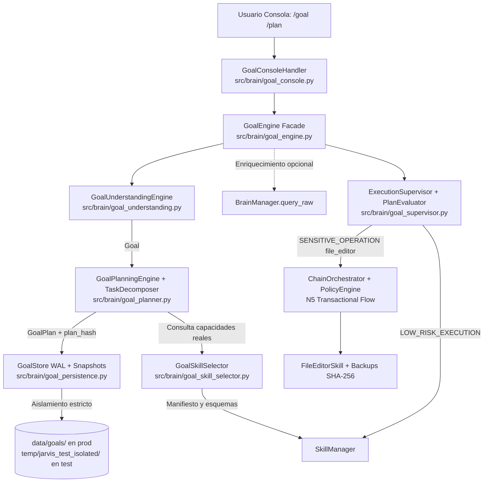
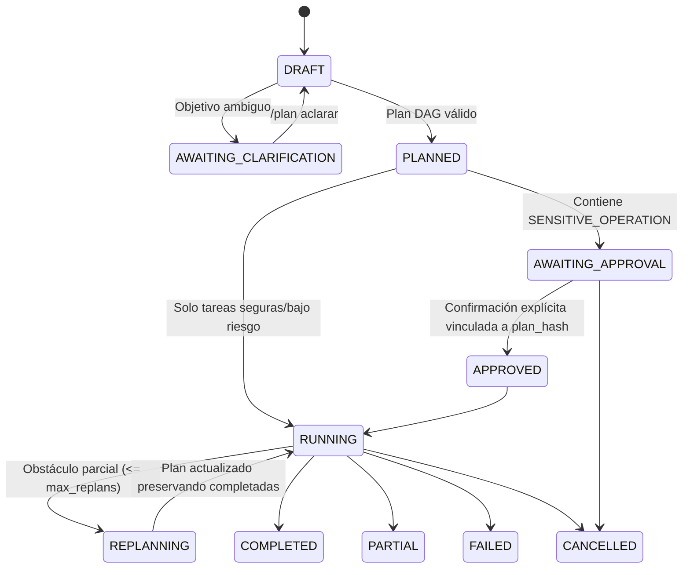

# PROYECTO J.A.R.V.I.S. — N6: AUTONOMOUS GOAL & PLANNING ENGINE

## 1. Propósito y Posición en el Roadmap

La fase **N6** introduce la primera capa de autonomía real y controlada en J.A.R.V.I.S.: permite recibir objetivos abiertos en lenguaje natural (por ejemplo: *"Jarvis, quiero optimizar el rendimiento de mi PC para jugar"*), comprender qué resultado busca el usuario, detectar restricciones o ambigüedades, descomponer el problema en un grafo dirigido acíclico (DAG) de subtareas, seleccionar capacidades reales registradas en `SkillManager`, supervisar la ejecución con límites estrictos y gestionar replanificaciones acotadas sin eludir jamás los controles de seguridad de N5 (`ChainOrchestrator`, `PolicyEngine` y aprobación explícita).

---

## 2. Arquitectura Modular de N6

### Componentes implementados

| Módulo | Responsabilidad principal | Límites arquitectónicos |
|---|---|---|
| `src/brain/goal_models.py` | Entidades (`Goal`, `GoalTask`, `GoalPlan`, `GoalEngineLimits`), máquinas de estado (`ALLOWED_GOAL_TRANSITIONS`, `ALLOWED_TASK_TRANSITIONS`), hashing estructural SHA-256 (`plan_hash`) y excepciones tipadas | Sin IO ni dependencias de audio/LLM |
| `src/brain/goal_skill_selector.py` | Validación contra `SkillManager`, compatibilidad de parámetros y clasificación en 3 niveles de riesgo | Nunca inventa tools inexistentes |
| `src/brain/goal_understanding.py` | Comprensión NL, detección de ambigüedad (`AWAITING_CLARIFICATION`), extracción de restricciones (`read_only`, `offline`) e información faltante | Fallback determinista completo sin internet |
| `src/brain/goal_planner.py` | Descomposición en subtareas, validación DAG mediante algoritmo de Kahn, cota de profundidad (`max_depth`) y cantidad (`max_tasks`) | Planificar jamás otorga aprobación |
| `src/brain/goal_persistence.py` | Persistencia aislada con WAL JSONL + snapshots atómicos (`flush` + `fsync` + `os.replace`) y redacción de secretos | Nunca lee ni toca `data/memory_store.json`; confinado bajo `temp/jarvis_test_isolated/` en test |
| `src/brain/goal_supervisor.py` | Supervisión DAG, prevención de duplicados, timeouts por tarea y globales, reintentos acotados, cancelación y replanificación preservando completadas | Delegación obligatoria a `ChainOrchestrator` + `PolicyEngine` para edición de archivos |
| `src/brain/goal_engine.py` | Fachada unificada de alto nivel para consola y API Python | Cero carga de módulos de voz (`stt`, `tts`, `recorder`, `faster_whisper`) |
| `src/brain/goal_console.py` | Parsing e interacción segura de `/goal`, `/plan`, `/plan ejecutar`, `/plan estado`, `/plan cancelar`, `/plan aclarar` | Confirmación explícita por defecto denegatoria (`default-deny`) |

---

## 3. Flujo de Estados y Frontera de Seguridad

### Categorías de riesgo aplicadas

1. **`SAFE_PLANNING`**: razonamiento interno, análisis, síntesis de evidencias locales sin efectos secundarios (`skill_name=None`).
2. **`LOW_RISK_EXECUTION`**: lecturas no destructivas y acotadas (`system_info`, `system_time`, `clipboard_manager(action="read")`, `web_search`, `web_extraction` con sobre no confiable). Bloqueables por `Constraints(read_only=True, allow_network=False)`.
3. **`SENSITIVE_OPERATION`**: toda acción que modifica disco, configuración o estado externo (`file_editor`, `document_export`, `app_launcher`, `activate_protocol`, `volume_control`, `media_control`, `system_power`, `clipboard_manager(action="write")`). Exige `requires_approval=True` y aprobación vinculada a `plan_hash`. Toda edición de configuración local se delega exclusivamente a `ChainOrchestrator` + `PolicyEngine`.

---

## 4. Configuración y Límites (`config/settings.py`)

| Variable de entorno | Valor por defecto | Propósito |
|---|---|---|
| `JARVIS_GOAL_MAX_TASKS` | `12` | Limita la cantidad total de subtareas por plan |
| `JARVIS_GOAL_MAX_DEPTH` | `5` | Limita la profundidad máxima del grafo de dependencias (DAG) |
| `JARVIS_GOAL_MAX_TASK_RETRIES` | `1` | Limita reintentos automáticos ante fallos transitorios |
| `JARVIS_GOAL_TASK_TIMEOUT_SEC` | `30.0` | Timeout máximo por subtarea individual |
| `JARVIS_GOAL_TOTAL_TIMEOUT_SEC` | `180.0` | Timeout máximo de ejecución global del objetivo |
| `JARVIS_GOAL_MAX_REPLANS` | `2` | Limita cantidad de replanificaciones automáticas por plan |
| `GOAL_STORE_DIR` | `BASE_DIR / "data" / "goals"` | Raíz de persistencia en producción (desactivada en `JARVIS_ENV=test`) |

---

## 5. Comandos de Consola Disponibles

- `/goal <objetivo>`: interpreta el objetivo y genera un `GoalPlan` estructurado (o solicita aclaración si es ambiguo). Nunca ejecuta operaciones sensibles automáticamente.
- `/plan`: muestra el plan activo, subtareas, dependencias, niveles de riesgo y resultados parciales.
- `/plan aclarar <texto>`: aporta contexto adicional cuando el objetivo quedó en `AWAITING_CLARIFICATION`.
- `/plan ejecutar`: supervisa la ejecución del plan activo en orden topológico; detiene y solicita confirmación interactiva explícita antes de cualquier operación sensible.
- `/plan estado`: informa avance actual, tareas completadas, aprobaciones pendientes y replanificaciones.
- `/plan cancelar [motivo]`: cancela ordenadamente el objetivo activo preservando el trabajo ya completado en historial.

---

## 6. Reglas de Aislamiento y Compatibilidad Multi-Brain

- **Memoria conversacional intacta**: `GoalStore` utiliza `data/goals/` en producción y `temp/jarvis_test_isolated/` en pruebas (`JARVIS_ENV=test` / `testing`), sin leer ni modificar `data/memory_store.json`.
- **Aislamiento de contenido web no confiable**: cualquier salida de `web_extraction` conserva su sobre estructurado en `GoalTask.untrusted_envelope` y se etiqueta explícitamente como dato pasivo durante síntesis posteriores.
- **Compatibilidad Multi-Brain**: `BrainManager.query_raw(...)` permite consultar Ollama, Gemini, Codex u OpenAI respetando cadenas de fallback y redacción de secretos sin contaminar el historial conversacional del usuario. El motor determinista garantiza operación completa incluso sin conexión o ante JSON malformado del modelo (*"el modelo propone, el motor valida"*).
