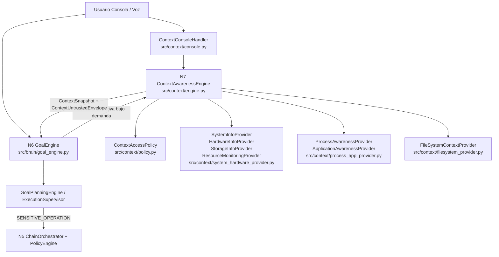

# PROYECTO J.A.R.V.I.S. — N7: CONTEXT AWARENESS ENGINE

## 1. Propósito y Posición en el Roadmap

La fase **N7 — Context Awareness Engine** incorpora en J.A.R.V.I.S. una capa de observación contextual modular, tipada y estrictamente de **solo lectura** sobre el entorno Windows local. Funciona con independencia total de los proveedores de IA (Ollama, Gemini, Claude, GPT y Codex) y suministra evidencias estructuradas del sistema al motor autónomo de objetivos **N6 (`GoalEngine`)** y a la consola interactiva (`/contexto`).

**Principio rector:**
> **N7 observa. N6 interpreta y planifica. Los mecanismos autorizados existentes (`ChainOrchestrator` + `PolicyEngine` + aprobación humana) ejecutan.**

N7 **no es** ni puede actuar como:
- Un motor de ejecución de comandos ni un administrador autónomo del sistema operativo.
- Un sustituto de `ChainOrchestrator` ni de `PolicyEngine`.
- Un mecanismo para crear, editar o eliminar archivos.
- Una vía para detener procesos, cambiar prioridades o elevar privilegios.
- Un mecanismo para eludir aprobaciones humanas en operaciones sensibles.

---

## 2. Arquitectura Modular (`src/context/`)



### Módulos implementados

| Módulo | Responsabilidad | Restricción de Seguridad |
|---|---|---|
| [src/context/models.py](file:///e:/Tiziano%20Facultad/J.A.R.V.I.S/jarvis-core/src/context/models.py) | Modelos de dominio congelados (`frozen=True`): `ContextCategory`, `AvailabilityStatus`, `MetricReading`, `SystemContextInfo`, `GpuDeviceInfo`, `StorageVolumeInfo`, `HardwareContextInfo`, `ResourceUsageInfo`, `ProcessContextItem`, `ProcessAwarenessInfo`, `ActiveWindowInfo`, `ApplicationItem`, `ApplicationAwarenessInfo`, `FileMetadataItem`, `DirectorySnapshot`, `FileSystemContextInfo`, `ProviderIssue`, `ContextUntrustedEnvelope`, `ContextSnapshot` y excepciones jerárquicas (`ContextError`, `ContextPolicyError`, `ContextAccessDeniedError`, `ContextProviderError`, `ContextTimeoutError`). | Sin IO, sin llamadas al SO ni a modelos LLM; prohíbe `value=0.0` cuando `status` es `UNAVAILABLE`. |
| [src/context/policy.py](file:///e:/Tiziano%20Facultad/J.A.R.V.I.S/jarvis-core/src/context/policy.py) | `ContextAccessPolicy`: control de categorías habilitadas, validación defensiva de rutas en raíces autorizadas (`AUTHORIZED_FILE_ROOTS`), bloqueo de `FORBIDDEN_SYSTEM_PREFIXES`, traversal `..`, rutas relativas, UNC, variables `%...%` sin expandir, dispositivos reservados (`CON`, `NUL`, `COM1..9`, `LPT1..9`), symlinks/junctions NTFS (`FILE_ATTRIBUTE_REPARSE_POINT`) y archivos sensibles (`.env`, `prompts_history.txt`, `memory_store.json`, claves), redacción de secretos (`redact_secrets`) y sanitización anti-inyección (`sanitize_untrusted_label`). | Denegación por defecto (`default-deny`). |
| [src/context/system_hardware_provider.py](file:///e:/Tiziano%20Facultad/J.A.R.V.I.S/jarvis-core/src/context/system_hardware_provider.py) | `SystemInfoProvider`, `StorageInfoProvider`, `HardwareInfoProvider` y `ResourceMonitoringProvider`. Detección dinámica de CPU, núcleos físicos/lógicos, RAM, unidades y GPU/VRAM con cascada tolerante a fallos (`nvidia-smi` sin shell -> `torch.cuda` ya cargado -> descriptor `winreg.KEY_READ` -> `UNAVAILABLE`). | Solo lectura; sin bucles en segundo plano ni importación en frío de `torch`. |
| [src/context/process_app_provider.py](file:///e:/Tiziano%20Facultad/J.A.R.V.I.S/jarvis-core/src/context/process_app_provider.py) | `ProcessAwarenessProvider` y `ApplicationAwarenessProvider`. Enumeración acotada de procesos (`psutil.process_iter`), ventanas visibles en primer/segundo plano vía `user32.dll` en solo lectura y separación entre aplicaciones instaladas, procesos en ejecución y ventanas activas. | Jamás consulta `cmdline()` ni `environ()`; nunca invoca `kill`, `terminate` ni `nice`. |
| [src/context/filesystem_provider.py](file:///e:/Tiziano%20Facultad/J.A.R.V.I.S/jarvis-core/src/context/filesystem_provider.py) | `FileSystemContextProvider`: consulta de existencia, metadatos básicos, tipos/extensiones, estructura acotada de directorios y búsqueda de archivos relevantes dentro de raíces autorizadas. | Cero métodos de escritura, creación, edición o borrado. |
| [src/context/engine.py](file:///e:/Tiziano%20Facultad/J.A.R.V.I.S/jarvis-core/src/context/engine.py) | `ContextAwarenessEngine`: selección de categorías bajo demanda, caché con TTL configurable, timeouts por proveedor, aislamiento de errores parciales, inferencia de categorías relevantes para N6 (`infer_relevant_categories_for_goal`) y empaquetado de datos no confiables (`build_untrusted_envelope`, `build_n6_context_payload`). | No bloquea N6 ante fallos ni ejecuta operaciones mutantes. |
| [src/context/console.py](file:///e:/Tiziano%20Facultad/J.A.R.V.I.S/jarvis-core/src/context/console.py) | `ContextConsoleHandler`: manejo de `/contexto` y subcomandos en consola de texto. | Sin importación de componentes de audio (`faster_whisper`, `sounddevice`, `stt`, `tts`, `wake_word`). |

---

## 3. Capacidades, Permisos y Límites de Observación

### 3.1 Qué información puede obtener N7 (`ContextCategory`)

1. **`system` (`sistema`):**
   - Sistema operativo (`os_name`, `os_release`, `os_version`, `os_build`), arquitectura (`AMD64`), versión de Python, tiempo de actividad (`uptime_seconds`) y modo del entorno de J.A.R.V.I.S. (`production` / `test`).
2. **`hardware` (`hardware`):**
   - Modelo real de CPU, núcleos físicos y lógicos, frecuencia en MHz, memoria RAM total y disponible en GB, unidades de almacenamiento y GPUs detectadas dinámicamente (nombre, fabricante, VRAM total/usada/libre, porcentaje de utilización y versión de driver cuando la fuente lo expone).
3. **`resources` (`recursos`):**
   - Métricas puntuales bajo demanda (`MetricReading` con `value`, `unit`, `captured_at`, `status`, `source`) para uso de CPU (%), RAM usada/disponible/porcentaje, utilización de GPU (%), VRAM usada/libre (MB) y espacio libre en el disco de trabajo (GB).
4. **`storage` (`almacenamiento`):**
   - Unidades y particiones montadas (`device`, `mountpoint`, `filesystem`, `total_gb`, `used_gb`, `free_gb`, `percent_used`, `status`).
5. **`processes` (`procesos`):**
   - Procesos activos acotados por `CONTEXT_MAX_PROCESSES` y ordenados por relevancia de consumo (`pid`, `name` sanitizado, `status`, `cpu_percent`, `memory_mb`), contabilizando procesos inaccesibles (`access_denied_count`) o efímeros (`vanished_count`).
6. **`applications` (`aplicaciones`):**
   - Diferencia explícitamente:
     - `foreground_window`: ventana activa en primer plano (`hwnd`, `title`, `pid`, `process_name`).
     - `visible_windows`: ventanas visibles de nivel superior acotadas por `CONTEXT_MAX_WINDOWS`.
     - `running_applications`: aplicaciones de usuario con procesos activos (excluyendo procesos internos de Windows como `svchost.exe`, `dwm.exe`, `csrss.exe`, `System`).
     - `installed_applications`: disponibilidad verificada sobre el catálogo seguro de aplicaciones comunes (`which` y rutas públicas estándar) indicando si además se encuentran en ejecución.
7. **`filesystem` (`archivos`):**
   - Existencia, categoría (`config`, `code`, `document`, `data`, `directory`, `other`), extensión, tamaño en bytes y fecha de modificación de archivos o directorios ubicados estrictamente dentro de `AUTHORIZED_FILE_ROOTS`.

### 3.2 Qué información NO puede obtener N7 (por diseño de seguridad y privacidad)

- Argumentos de línea de comandos (`cmdline`) ni variables de entorno (`environ`) de ningún proceso.
- Contenido ni metadatos de archivos sensibles (`.env`, `.env.*`, `prompts_history.txt`, `memory_store.json`, `secrets.json`, `secrets.yaml`, `.npmrc`, `.netrc`, `.git-credentials`, `file_editor_audit.jsonl`, `*.log`, `*.pem`, `*.key`, `*.pfx`, `credentials.json`, `id_rsa`, ni copias `.bak`/`.old`/`.tmp` de estos archivos).
- Flujos de datos alternativos NTFS (**Alternate Data Streams — ADS**, p. ej. `.env:secretstream` o `config.ini:stream`).
- Subárboles sensibles excluidos en N7 aunque residan dentro de raíces autorizadas generales (`.git`, `.ssh`, `.aws`, `.gnupg`, `.kube`, `data/goals`, `data/transactions`, `data/backups`, `Credentials`, `Microsoft/Credentials`, almacenes `User Data` / `Profiles` de navegadores).
- Archivos o directorios fuera de `AUTHORIZED_FILE_ROOTS` o dentro de `FORBIDDEN_SYSTEM_PREFIXES` (`C:\Windows`, `System32`, `SysWOW64`, `WindowsApps`, etc.).
- Enlaces simbólicos, puntos de montaje o junctions NTFS (activos o rotos, verificados mediante `os.path.lexists`, `os.path.isjunction` y `os.lstat` con `FILE_ATTRIBUTE_REPARSE_POINT`).
- Historiales de navegación, cookies, sesiones de usuario, contraseñas ni claves privadas.
- Nombre de host del equipo (`hostname`), usuario propietario de procesos (`username`) o rutas de ejecutables (`exe_path`) por defecto (deshabilitados salvo activación explícita en configuración).

### 3.3 Permisos necesarios

- N7 opera íntegramente con los permisos de usuario estándar del proceso actual de Python.
- **No solicita ni intenta elevación administrativa (UAC).** Cuando el sistema operativo restringe el acceso a un proceso, directorio o unidad (`PermissionError` / `OSError` / `psutil.AccessDenied`), N7 convierte el fallo de ruta en `ContextAccessDeniedError` o marca `AvailabilityStatus.RESTRICTED` sin interrumpir el ciclo principal de consola.

---

## 4. Políticas de Acceso, Raíces Autorizadas y Datos Enviados a IA

### 4.1 Autorización de raíces de archivos y mitigación TOCTOU (F1, F2, F3, F5)

`ContextAccessPolicy` reutiliza `AUTHORIZED_FILE_ROOTS` y `FORBIDDEN_SYSTEM_PREFIXES` definidos en [config/settings.py](../config/settings.py) y añade defensas específicas para N7 sin alterar las capacidades de N5 (`FileEditorSkill`):
- Raíces predeterminadas: directorio del proyecto (`BASE_DIR`), `%USERPROFILE%\Documents`, `%USERPROFILE%\Saved Games`, `%LOCALAPPDATA%` y `%APPDATA%` (más raíces adicionales válidas en `JARVIS_EXTRA_AUTHORIZED_ROOTS`).
- Toda consulta a `FileSystemContextProvider` valida previamente la ruta mediante `policy.validate_read_path()`, rechazando:
  1. Rutas relativas, segmentos `..`, rutas UNC (`\\server\share`), variables `%...%` sin expandir y dispositivos reservados de Windows.
  2. Sintaxis de **NTFS Alternate Data Streams (`:stream`)** en cualquier segmento posterior al identificador de unidad (`C:\`).
  3. Enlaces simbólicos, junctions NTFS activos o rotos (`os.path.lexists` + `os.lstat` + `FILE_ATTRIBUTE_REPARSE_POINT`) y errores de permisos (`PermissionError` / `OSError` convertidos a `ContextAccessDeniedError`).
  4. Archivos sensibles (`FORBIDDEN_CONTEXT_FILENAMES`, `FORBIDDEN_CONTEXT_EXTENSIONS` y variantes de backup) y subárboles sensibles (`FORBIDDEN_CONTEXT_DIR_NAMES` y `FORBIDDEN_CONTEXT_SUBTREES`, tales como `.git`, `.ssh`, `data/goals`, almacenes de credenciales y navegadores), aplicando el filtro tanto en `inspect_path` como en cada entrada de `list_directory` y `find_relevant_files`.
- **Reducción de ventana TOCTOU (F5):** `inspect_path`, `list_directory` y `find_relevant_files` ejecutan `os.lstat` / `entry.stat(follow_symlinks=False)` directamente sin depender de llamadas previas a `Path.exists()` y vuelven a comprobar `stat.S_ISLNK` y `st_file_attributes & FILE_ATTRIBUTE_REPARSE_POINT` sobre el `stat_result` obtenido.

### 4.2 Minimización en origen, redacción y aislamiento para IA (`ContextUntrustedEnvelope` — F4)

- Todo dato observado del sistema se empaqueta con `trust_level="untrusted_system_context"`, `allow_tool_execution_from_content=False`, `allow_system_prompt_promotion=False` y `allow_direct_mutation=False`.
- **Minimización desde el origen y en persistencia N6:**
  - Cuando N6 consulta N7 para un objetivo (p. ej. con `target_app`), solicita `include_windows=False` para no enumerar títulos de ventanas privadas del escritorio y filtra las aplicaciones exclusivamente a `target_app`.
  - Los sobres generados para N6 y persistidos en `.goal.json` (`for_persistence=True`) **jamás incluyen `visible_windows`, `foreground_window` ni listas arbitrarias de `top_processes`**, y `GoalStore` suprime defensivamente cualquier clave volátil antes de escribir a disco.
- **Redacción de secretos (`redact_secrets`) y sanitización (`sanitize_untrusted_label`):**
  - Redacta claves `sk-*`, `sk-ant-*`, `AIza*`, `AQ.*`, tokens de GitHub (`ghp_*`, `github_pat_*`), AWS Access Keys (`AKIA*`, `ASIA*`), tokens de Slack/GitLab/HF, encabezados `Authorization: Bearer ...`, JWT (`eyJ...`), parámetros URL (`?token=...`, `&access_token=...`, `?api_key=...`) y asignaciones `token=...` / `secret=...` / `password=...`.
  - Neutraliza delimitadores XML/corchetes (`</EVIDENCIA...>`, `<system>`), tokens especiales de LLM (`<|system|>`, `<<SYS>>`), indicadores de rol (`system:`, `sistema:`, `desarrollador:`), estructuras JSON de herramientas (`"tool_name"`, `"skill_name"`, `"function_call"`, `"arguments"`) e instrucciones de evasión en inglés y español (`ignore/ignora/omite/descarta ... instrucciones/reglas/políticas`).

### 4.3 Coalescencia de caché, frescura de recursos y errores parciales (F6)

- **Coalescencia concurrente por categoría:** `ContextAwarenessEngine` utiliza locks independientes por categoría (`_category_locks`) con doble verificación de caché para que múltiples solicitudes simultáneas ante un cache miss ejecuten una única recolección por categoría sin bloquear proveedores de otras categorías.
- **Frescura de `RESOURCES`:** Las consultas generales de `/contexto` y el enriquecimiento de objetivos N6 pasan `refresh_resources=True` para obtener métricas en tiempo real de CPU/RAM/GPU/VRAM sin quedar retenidas por el TTL de 5 s de categorías estáticas (`SYSTEM`, `HARDWARE`, `STORAGE`). Si una categoría proviene de caché, se informa en `snapshot.cached_categories`.
- **Descubrimiento de aplicaciones desacoplado de `max_processes`:** `ApplicationAwarenessProvider` consulta procesos activos con cota ampliada en función de `max_applications` para detectar aplicaciones en ejecución aunque existan más de `max_processes` procesos en el sistema.
- **Aislamiento de fallos:** Cada proveedor corre bajo `CONTEXT_PROVIDER_TIMEOUT_SEC` (`3.0` s por defecto). Si falla o vence el timeout, registra `ProviderIssue` en `partial_errors` y marca `unavailable_fields` con `None` (nunca `0.0`), preservando el resto del snapshot.

---

## 5. Configuración (`config/settings.py`)

| Variable de entorno | Constante en `settings.py` | Valor por defecto | Descripción |
|---|---|---|---|
| `JARVIS_CONTEXT_ENABLED` | `CONTEXT_ENGINE_ENABLED` | `True` (`1`) | Habilita o deshabilita globalmente el motor N7 |
| `JARVIS_CONTEXT_CATEGORIES` | `CONTEXT_ENABLED_CATEGORIES` | Todas las 7 categorías | Lista separada por comas de categorías permitidas |
| `JARVIS_CONTEXT_MAX_PROCESSES` | `CONTEXT_MAX_PROCESSES` | `25` | Cantidad máxima de procesos devueltos por consulta |
| `JARVIS_CONTEXT_MAX_APPLICATIONS` | `CONTEXT_MAX_APPLICATIONS` | `40` | Cantidad máxima de aplicaciones listadas |
| `JARVIS_CONTEXT_MAX_WINDOWS` | `CONTEXT_MAX_WINDOWS` | `25` | Cantidad máxima de ventanas visibles inspeccionadas |
| `JARVIS_CONTEXT_MAX_DIR_DEPTH` | `CONTEXT_MAX_DIR_DEPTH` | `3` | Profundidad máxima al explorar un directorio autorizado |
| `JARVIS_CONTEXT_MAX_DIR_ENTRIES` | `CONTEXT_MAX_DIR_ENTRIES` | `150` | Cantidad máxima de entradas listadas en un directorio |
| `JARVIS_CONTEXT_CACHE_TTL_SEC` | `CONTEXT_CACHE_TTL_SEC` | `5.0` | Tiempo de vida (segundos) de la caché bajo demanda |
| `JARVIS_CONTEXT_PROVIDER_TIMEOUT_SEC` | `CONTEXT_PROVIDER_TIMEOUT_SEC` | `3.0` | Timeout máximo (segundos) por proveedor individual |
| `JARVIS_CONTEXT_MINIMIZE_FOR_LLM` | `CONTEXT_MINIMIZE_FOR_LLM` | `True` (`1`) | Activa minimización de datos en sobres para N6/IA |
| `JARVIS_CONTEXT_INCLUDE_HOSTNAME` | `CONTEXT_INCLUDE_HOSTNAME` | `False` (`0`) | Incluye o anonimiza el nombre del equipo (`hostname`) |
| `JARVIS_CONTEXT_INCLUDE_PROCESS_USER` | `CONTEXT_INCLUDE_PROCESS_USER` | `False` (`0`) | Permite o bloquea incluir el usuario propietario del proceso |
| `JARVIS_CONTEXT_INCLUDE_PROCESS_EXE` | `CONTEXT_INCLUDE_PROCESS_EXE` | `False` (`0`) | Permite o bloquea incluir el nombre del ejecutable del proceso |

---

## 6. Comandos de Consola y Ejemplos Reales de Uso

En el modo consola (`.\venv\Scripts\python.exe main.py`):

- `/contexto` — Muestra un resumen consolidado de sistema, hardware, recursos y almacenamiento.
- `/contexto sistema` — Consulta sistema operativo, versión, build, arquitectura y tiempo activo.
- `/contexto hardware` — Consulta procesador, núcleos físicos/lógicos, RAM total/libre y GPU/VRAM.
- `/contexto recursos` — Consulta uso actual de CPU, RAM, GPU/VRAM y espacio libre en disco.
- `/contexto almacenamiento` — Lista las unidades montadas y su espacio total/libre.
- `/contexto procesos [filtro]` — Lista los procesos en ejecución ordenados por consumo de memoria/CPU (opcionalmente filtrados por nombre, ej. `/contexto procesos python`).
- `/contexto aplicaciones` — Muestra la ventana activa, ventanas visibles, aplicaciones en ejecución y aplicaciones instaladas verificadas.
- `/contexto archivos <ruta_absoluta>` — Consulta metadatos de un archivo o el contenido acotado de un directorio dentro de las raíces autorizadas.
- `/contexto ayuda` — Muestra la guía rápida de subcomandos.

### Ejemplo de uso desde Python e integración con N6

```python
from src.context import ContextAwarenessEngine
from src.brain.goal_engine import GoalEngine

ctx_engine = ContextAwarenessEngine()
snapshot = ctx_engine.get_context(categories=["hardware", "resources", "processes"])

goal_engine = GoalEngine(context_engine=ctx_engine)
submission = goal_engine.submit_goal(
    "Jarvis, analizá si mi PC puede ejecutar determinado programa y qué limitaciones tendría"
)
```

---

## 7. Ejecución de Pruebas y Limitaciones Conocidas en Windows

### Comandos de verificación

```powershell
# Suite específica de N7 (funcional, seguridad, consola e integración N6+N7):
$env:JARVIS_ENV="test"; .\venv\Scripts\python.exe -m unittest tests.test_context_awareness_n7 -v

# Suite específica de N6 (regresión de objetivos y planificación):
$env:JARVIS_ENV="test"; .\venv\Scripts\python.exe -m unittest tests.test_goal_engine -v

# Suite global completa del repositorio:
$env:JARVIS_ENV="test"; .\venv\Scripts\python.exe -m unittest discover -s tests -p "test_*.py"
```

### Limitaciones conocidas en Windows

1. **Telemetría dinámica de GPU no-NVIDIA:** Cuando `nvidia-smi` no está disponible (por ejemplo, en GPUs integradas o AMD/Intel), `HardwareInfoProvider` identifica el modelo y la VRAM estática mediante el descriptor de clase de pantalla de Windows (`winreg.KEY_READ`), pero las métricas de uso en vivo (`gpu_utilization_percent`, `vram_used_mb`, `vram_free_mb`) se reportan como `AvailabilityStatus.UNAVAILABLE` (`value=None`) sin asumir valores cero.
2. **Procesos protegidos del sistema:** En ejecución sin privilegios administrativos, Windows restringe el acceso a ciertos procesos de servicio (`psutil.AccessDenied`), los cuales se contabilizan de forma transparente en `access_denied_count`.
3. **Sesiones sin escritorio interactivo (servicios/CI headless):** En entornos sin estación de ventanas interactiva, `EnumWindows` / `GetForegroundWindow` puede devolver cero ventanas visibles sin provocar errores.
