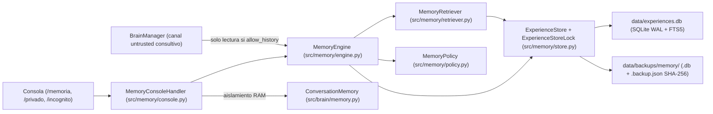

# J.A.R.V.I.S. — N8: Long-Term Memory & Experience (N8.1 + N8.2 + N8.3 Subfases 1 y 2)

> [!IMPORTANT]
> **Alcance implementado actualmente:** Este documento cubre **N8.1** (persistencia base, modelos, políticas y locking), **N8.2** (recuperación determinista, API central, consola `/memoria` y `/privado`/`/incognito`, importación manual de preferencias, purga física y backups/restauración), **N8.3 Subfase 1** (migración SQLite v1 -> v2, idempotencia estricta para `EXECUTION_VERIFIED`, `store_version_token` monótono e `invalidate_by_execution()`) y **N8.3 Subfase 2** (`capture_contracts.py` v2.0, `N5ExecutionEvidenceAdapter`, `N6GoalEvidenceAdapter`, `ExperienceCaptureService` desacoplado e invalidación automática por rollback N5 confirmado + tombstone).
> Permanecen reservadas y sin activar las subfases siguientes de **N8.3** (`EphemeralGoalStore` / referencias N8 en `GoalStore`, integración consultiva en `GoalEngine` / `TaskDecomposer` / `BrainManager` y `MemorySnapshotGuard` validado por `store_version_token`), así como embeddings y consolidación por LLM.

---

## 1. Arquitectura N8.1 + N8.2 y Separación entre Capas



**Reglas arquitectónicas innegociables:**
- N8 es estrictamente consultivo: **nunca** autoriza operaciones, aprueba planes, modifica políticas de N5 ni escribe archivos de usuario.
- Los recuerdos recuperados se entregan encapsulados como **`untrusted_long_term_memory`** (`allow_system_prompt_promotion=False`, `allow_tool_execution_from_content=False`, `allow_permission_grant=False`); jamás ingresan al `system_prompt` como instrucciones privilegiadas.
- N8 no duplica `GoalStore` (N6) ni altera `data/memory_store.json` de forma automática.
- Inicializar `MemoryEngine`, `MemoryRetriever` o `MemoryConsoleHandler` **no carga** Whisper, micrófono, `AudioRecorder`, `WakeWordDetector` ni TTS.

---

## 2. Módulos del Paquete (`src/memory/`)

| Archivo | Fase | Responsabilidad |
| :--- | :---: | :--- |
| [models.py](file:///e:/Tiziano%20Facultad/J.A.R.V.I.S/jarvis-core/src/memory/models.py) | N8.1/N8.2/N8.3-S1 | Enumeraciones (`MemoryAuditAction.REJECT_IDEMPOTENCY_CONFLICT`), máquina de estados, excepciones tipadas (`MemoryIdempotencyConflictError`, etc.) y contratos DTO (`ExecutionVerificationEvidence` con `canonical_unit_id`, `MemoryCreateInput`, `MemoryRecord`, `ExecutionInvalidationResult`, `MemoryRetrievalResult` y `StoreStats` con `store_version_token`). |
| [policy.py](file:///e:/Tiziano%20Facultad/J.A.R.V.I.S/jarvis-core/src/memory/policy.py) | N8.1/N8.2/N8.3-S1 | `MemoryPolicy`, `sanitize_memory_text()`, detección sin exposición de secretos (`assert_no_secrets` + `redact_secrets`), bloqueo de `INFERENCE`, validación `EXECUTION_VERIFIED`, derivación determinista `compute_default_canonical_unit_id()` / `compute_execution_idempotency_key()` y sandbox `JARVIS_ENV=test`. |
| [migrations.py](file:///e:/Tiziano%20Facultad/J.A.R.V.I.S/jarvis-core/src/memory/migrations.py) | N8.1/N8.3-S1 | Esquema SQLite versionado v1 -> v2 (`canonical_unit_id`, `idempotency_key`, reconstrucción de `memory_audit`, índices de idempotencia/ejecución, `store_version_epoch` / `store_version_seq` / `store_version_token`), tokenizer `unicode61 remove_diacritics 2` y pragmas `WAL` + `synchronous=FULL` + `secure_delete=ON` + `foreign_keys=ON`. |
| [store.py](file:///e:/Tiziano%20Facultad/J.A.R.V.I.S/jarvis-core/src/memory/store.py) | N8.1/N8.2/N8.3-S1/S2 | `ExperienceStoreLock` y `ExperienceStore`: CRUD transaccional (`BEGIN IMMEDIATE`), idempotencia estricta `EXECUTION_VERIFIED` sin fusión entre ejecuciones, dedupe convencional por `content_fingerprint`, actualización atómica de `store_version_token`, `invalidate_by_execution()`, tombstones persistentes de rollback (`is_execution_invalidated()`, `mark_execution_rollback_tombstone()`), backups y restauración compatible v1/v2 con verificación inmediata. |
| [retriever.py](file:///e:/Tiziano%20Facultad/J.A.R.V.I.S/jarvis-core/src/memory/retriever.py) | N8.2/N8.3-S1 | Recuperación determinista FTS5/BM25 + fallback SQL `LIKE` junto con lectura atómica del `store_version_token` del snapshot recuperado. |
| [engine.py](file:///e:/Tiziano%20Facultad/J.A.R.V.I.S/jarvis-core/src/memory/engine.py) | N8.2/N8.3-S1/S2 | API central `MemoryEngine`: coordinación de políticas, modo privado, ciclo de vida completo, `get_store_version_token()`, `invalidate_by_execution()`, tombstones de rollback (`is_execution_invalidated()`, `mark_execution_rollback_tombstone()`), backups/restauración e importación manual read-only desde JSON legacy. |
| [capture_contracts.py](file:///e:/Tiziano%20Facultad/J.A.R.V.I.S/jarvis-core/src/memory/capture_contracts.py) | N8.3-S2 | Contrato versionado `CAPTURE_CONTRACT_VERSION="2.0"`, referencias inmutables (`VerifiedOperationReference`), validación de verificadores autorizados (`AUTHORIZED_VERIFIERS_BY_LAYER`), digests `evidence_sha256` / `contract_sha256` deterministas y rechazo de `verified=True`, LLM/síntesis, transcripts, web cruda o secretos (`MemoryEvidenceContractError`). |
| [capture.py](file:///e:/Tiziano%20Facultad/J.A.R.V.I.S/jarvis-core/src/memory/capture.py) | N8.3-S2 | `N5ExecutionEvidenceAdapter`, `N6GoalEvidenceAdapter` (`COMPLETED` / `PARTIAL` tarea a tarea verificada) y coordinador desacoplado `ExperienceCaptureService` con puertas de privacidad/flags, aislamiento total de fallos e invalidación/tombstone por rollback N5 confirmado. |
| [console.py](file:///e:/Tiziano%20Facultad/J.A.R.V.I.S/jarvis-core/src/memory/console.py) | N8.2 | Comandos de consola `/memoria`, `/privado` e `/incognito` con validación de argumentos, vistas previas y confirmación interactiva antes de acciones destructivas. |

---

## 3. Recuperación Determinista, Ranking y Presupuestos (`MemoryRetriever`)

1. **Motores:** FTS5 con `bm25(memory_fts)` y tokenizer `unicode61 remove_diacritics 2`, con respaldo automático parametrizado SQL `LIKE ESCAPE '\'` sobre `normalized_text`.
2. **Filtros obligatorios previos al ranking:**
   - Solo estado `ACTIVE` (salvo consultas administrativas explícitas en `store.list_memories`).
   - Excluye `REVOKED`, `SUPERSEDED`, `EXPIRED`, recuerdos con `expires_at` vencido y recuerdos en espera de confirmación (`pending_confirmation=True`) hasta su confirmación explícita.
   - Respeta el ámbito solicitado: `GLOBAL`, `PROJECT` o `APP_OR_GAME` sin mezclar proyectos ni juegos ajenos.
3. **Límite de tokens de búsqueda:** `tokenize_query()` normaliza Unicode y acota la consulta a `N8_SEARCH_MAX_TOKENS` (`10` tokens por defecto).
4. **Fórmula de ranking determinista** *(sin LLM ni embeddings; no fusiona dos recuerdos con distinto `memory_id` por similitud textual)*:
   - `0.40` relevancia textual (cobertura de tokens + señal BM25/SQL)
   - `0.20` coincidencia exacta de ámbito (`PROJECT` / `APP_OR_GAME` supera a `GLOBAL`)
   - `0.15` confianza declarada (`0.0..1.0`)
   - `0.15` confiabilidad de fuente (`EXECUTION_VERIFIED=1.00`, `DECISION_CONFIRMED=0.90`, `USER_EXPLICIT=0.85`)
   - `0.07` vigencia/recencia e importancia
   - `0.03` estado verificado (`last_verified_at`).
5. **Presupuestos iniciales (`config/settings.py`):**

| Destino (`MemoryRetrievalTarget`) | Máximo de recuerdos | Máximo de caracteres |
| :--- | :---: | :---: |
| `NORMAL` (consulta estándar) | `5` (`N8_TEXT_MAX_ITEMS`) | `1500` (`N8_TEXT_MAX_CHARS`) |
| `VOICE` / `LOCAL_3B` (voz y modelo local 3B) | `3` (`N8_VOICE_MAX_ITEMS`) | `600` (`N8_VOICE_MAX_CHARS`) |

---

## 4. Ciclo de Vida Completo y Comandos de Consola

| Comando | Operación | Confirmación previa | Efecto principal |
| :--- | :--- | :---: | :--- |
| `/memoria ayuda` | Ayuda | No | Lista sintaxis de comandos N8.2 y modo privado. |
| `/memoria buscar <consulta>` | Consulta rankeada | No | Recupera `ACTIVE` confirmados dentro de presupuesto (`--voz`, `--proyecto`, `--app`). |
| `/memoria listar [filtro]` | Listado administrativo | No | Lista `activos`, `pendientes`, `revocados`, `expirados` o `todos`. |
| `/memoria ver <id>` | Detalle e historial | No | Muestra contenido, metadatos, revisión actual e historial previo. |
| `/memoria corregir <id> [texto]` | Revisión inmutable | No | Incrementa `revision_number` y guarda el estado anterior en `memory_revisions`. |
| `/memoria confirmar <id>` | Confirmación | No | Promueve recuerdos pendientes (o revalida activos) con `last_verified_at`. |
| `/memoria olvidar <id> [motivo]` | Revocación lógica | No | Cambia a `REVOKED`, purga fila de `memory_fts` y conserva trazabilidad legal/auditoría. |
| `/memoria purgar <id>` | Eliminación física SQLite | **Sí** | Borra registro, `memory_fts`, `memory_revisions` y filas de `memory_audit` asociadas. |
| `/memoria importar-preferencias [ruta]` | Importación manual JSON | **Sí (preview)** | Lee JSON en solo lectura, clasifica `NEW`/`DUPLICATE`/`CONFLICT`/`REJECTED` y aplica solo tras confirmar. |
| `/memoria backup` | Snapshot consistente | No | Ejecuta `sqlite3.Connection.backup()`, valida integridad y guarda SHA-256. |
| `/memoria restaurar [id\|num]` | Restauración atómica | **Sí** | Valida SHA-256 + SQLite, preserva DB previa y reemplaza mediante `os.replace()`. |
| `/privado` / `/incognito` | Alternar privacidad | No | Activa Opción A (lectura permitida, cero escrituras/auto-save) o sale descartando buffers RAM. |
| `/privado --sin-historial` / `/incognito --sin-historial` | Aislamiento estricto | No | Modo privado sin lectura de recuerdos históricos N8 ni memoria conversacional previa. |

---

## 5. Modo Privado — Aislamiento Real (Opción A y `--sin-historial`)

La protección no depende de instrucciones al modelo LLM sino de controles estructurales en código:

1. **Buffers separados en RAM (`ConversationMemory`):** `_private_mode`, `_private_allow_history`, `_private_messages`, `_private_message_metadata`, `_private_external_references` y `_private_metadata`.
2. **Bloqueo incondicional de persistencia:** mientras `_private_mode=True`:
   - `ConversationMemory._save_to_disk()` y `save_to_disk()` retornan `False` inmediatamente sin tocar archivos ni crear `.tmp`.
   - `MemoryEngine` bloquea toda escritura (`create_memory`, `correct_memory`, `confirm_memory`, `revoke_memory`, `purge_memory`, `create_backup`, `restore_backup`, `commit_preferences_import`) lanzando `MemoryPrivateModeError`.
   - En `main.py`, operaciones persistentes externas como `/optimizar`, `/rollback`, `/goal` y mutaciones `/plan` se rechazan de forma explícita durante `/privado`.
3. **Sin historial (`--sin-historial`):** desactiva lecturas previas en `ConversationMemory` y bloquea `MemoryEngine.retrieve()` devolviendo resultado vacío con `blocked_by_history_policy=True`.
4. **Cero fugas en logs y herramientas:** `SkillManager.set_private_mode(True)` y `IntentRouter` omiten argumentos crudos, respuestas crudas y `traceback` cuando el modo privado está activo.
5. **Salida limpia:** `exit_private_mode()` vacía y descarta todos los buffers `_private_*` sin mezclarlos jamás con `self._messages` ni `self.preferences`; los guardados posteriores (`auto_save=True`) excluyen todo turno privado previo.

---

## 6. Importación Manual de Preferencias (`data/memory_store.json`)

- **Nunca automática al iniciar.** Solo se ejecuta bajo `/memoria importar-preferencias`.
- Abre el JSON origen estrictamente en **solo lectura** y **jamás modifica el archivo origen**.
- Rechaza JSON corrupto o estructuras inesperadas sin campo diccionario `preferences` sin sobrescribir nada.
- No importa mensajes conversacionales sueltos (`messages`), objetos complejos, claves sensibles (`api_key`, `password`, `token`, etc.), secretos ni marcadores de inferencia.
- Muestra vista previa diferenciando `NEW`, `DUPLICATE`, `CONFLICT` y `REJECTED`, exigiendo confirmación explícita (`skip` conservador por defecto o `sobrescribir` marcando el previo como `SUPERSEDED`).
- En `JARVIS_ENV=test`, rechaza por política intentar leer el archivo real `data/memory_store.json` (`MemoryPolicyError`).

---

## 7. Revocación Lógica, Purga Física y Backups / Restauración

### Purga física (`purge_memory`) y limitaciones reales
- Bajo `ExperienceStoreLock`, borra transaccionalmente (`BEGIN IMMEDIATE`) filas en `memory_fts`, referencias `superseded_by`, `memory_revisions`, filas de `memory_audit` vinculadas al `memory_id` (dejando solo un tombstone anonimizado con SHA-256 del ID sin texto del recuerdo) y el registro en `memories`; luego ejecuta `PRAGMA wal_checkpoint(TRUNCATE)` (con `PRAGMA secure_delete=ON` activo en todas las conexiones) y `VACUUM` opcional.
- **Limitación documentada honestamente:** aunque SQLite sobrescribe con ceros sus páginas libres, ningún software de aplicación puede garantizar borrado irrecuperable frente a wear-leveling de SSDs, journals/MFT de NTFS, instantáneas Shadow Copies (VSS) de Windows ni backups previos creados fuera o antes de la purga.

### Backups (`data/backups/memory/`) y restauración atómica
- **Creación (`create_backup`):** usa `sqlite3.Connection.backup()` bajo `ExperienceStoreLock` hacia archivo temporal, valida `PRAGMA quick_check == 'ok'`, `integrity_check == 'ok'`, `foreign_key_check == []`, calcula `SHA-256`, publica con `os.replace()` junto a su descriptor `.backup.json` sin credenciales y **solo tras validar el nuevo backup** aplica retención máxima (`N8_BACKUP_MAX_RETENTION = 5`).
- **Restauración (`restore_from_backup`):** verifica `SHA-256` + integridad SQLite del snapshot antes de adquirir bloqueo exclusivo; dentro de `ExperienceStoreLock`, consolida WAL si la DB actual es legible, guarda una copia previa verificada por SHA-256 en `preserved_pre_restore_<uuid>/` (incluso si la DB activa estaba corrupta), limpia `-wal`/`-shm`/`-journal` obsoletos, sustituye atómicamente vía archivo staging sincronizado con `os.fsync()` + `os.replace()` y verifica integridad post-swap (revirtiendo a la copia preservada si fallara).
- **Limitación en sistema de archivos:** en Windows, la sustitución atómica `os.replace()` exige que el archivo temporal de staging resida en el mismo volumen que `data/experiences.db` (garantizado ubicándolo en `db_path.parent`) y presupone que ningún proceso externo ajeno a J.A.R.V.I.S. mantenga abierto sin lock el archivo `.db`.

---

## 8. Concurrencia, Configuración, Protección de Datos y Límites N8.3

- **Concurrencia real:** Todas las operaciones (`create`, `revise`, `confirm`, `revoke`, `purge`, `backup`, `restore`, `verify_integrity`, `retrieve`) comparten `ExperienceStoreLock` (RLock modular por ruta canónica + `msvcrt.locking` en Windows / `fcntl.flock` en POSIX). Validado mediante subprocesos independientes reales en `writer-vs-purge` y `writer-vs-restore`.
- **Protección Git:** `.gitignore` y `src/utils/git_guard.py` (`GitSafetyGuard`) bloquean `data/`, `experiences.db*`, `-wal`, `-shm`, `-journal`, `.db.lock`, `.backup.json`, `.db.sha256`, `data/backups/memory/`, `.restore_staging_*`, `.pre_restore_*` y `*.corrupt.*`.
- **Aislamiento de tests (`JARVIS_ENV=test`):** redirige DB y backups bajo `temp/jarvis_test_isolated/` y prohíbe acceder a `data/memory_store.json`, `data/experiences.db` o `data/backups/` reales.
- **Límites respecto a subfases siguientes de N8.3:** la captura verificada automática y la invalidación por rollback ya están implementadas en Subfase 2 (`N8_AUTO_CAPTURE_ENABLED` continúa en `False` por defecto en producción); todavía permanecen sin implementar ni integrar `EphemeralGoalStore` / referencias N8 en `GoalStore` (Subfase 3), la recuperación consultiva en `GoalEngine` / `TaskDecomposer` / `BrainManager` con `MemorySnapshotGuard` validado por `store_version_token` (Subfase 4), los embeddings y la consolidación por LLM.

---

## 9. Esquema SQLite v2, Idempotencia Estricta y Coherencia de Snapshot (N8.3 Subfase 1)

1. **Migración incremental v1 -> v2 (`apply_migrations`):**
   - Añade columnas `canonical_unit_id` e `idempotency_key` a `memories` y ejecuta backfill determinista sobre filas `EXECUTION_VERIFIED` previas respetando unidades activas e inactivas.
   - Reconstruye `memory_audit` preservando filas históricas para ampliar el `CHECK` con `REJECT_IDEMPOTENCY_CONFLICT`.
   - Reemplaza `idx_memories_active_exec_provenance` por:
     - `idx_memories_idempotency_key` (`UNIQUE` sobre `idempotency_key WHERE idempotency_key IS NOT NULL`, cubriendo todos los estados para impedir resurrecciones silenciosas tras rollback).
     - `idx_memories_active_exec_unit` (`UNIQUE` sobre `(source_layer, source_execution_id, COALESCE(source_plan_id, ''), COALESCE(source_task_id, ''), canonical_unit_id)` cuando `source = 'EXECUTION_VERIFIED' AND status = 'ACTIVE'`).
     - `idx_memories_source_execution_id` para invalidación indexada en rollbacks.
   - Restringe `idx_memories_active_fingerprint` a `WHERE status = 'ACTIVE' AND source != 'EXECUTION_VERIFIED'`.

2. **Separación entre dedupe convencional e idempotencia `EXECUTION_VERIFIED`:**
   - Orígenes convencionales (`USER_EXPLICIT`, `DECISION_CONFIRMED`): continúan aplicando deduplicación canónica por `content_fingerprint` únicamente frente a registros convencionales `ACTIVE`.
   - Origen `EXECUTION_VERIFIED`: nunca colisiona por `content_fingerprint` entre ejecuciones diferentes; primero valida `idempotency_key`:
     - Si existe y el payload + evidencia coinciden -> devuelve `DEDUPE_HIT` (`matched_reason="idempotency_key"`) sin mutar estado ni avanzar `store_version_token`.
     - Si existe con evidencia o payload incompatible -> registra `REJECT_IDEMPOTENCY_CONFLICT` en `memory_audit` sin exponer secretos, mantiene `memories` y `store_version_token` intactos, y lanza `MemoryIdempotencyConflictError`.
     - Una misma tarea/ejecución puede registrar múltiples unidades independientes (`canonical_unit_id` distintos, e incluso `EXPERIENCE` + `FACT` por unidad predeterminada) sin colapsar.

3. **`store_version_token` (`<epoch>:<seq>`) persistente y atómico:**
   - Persistido en `store_metadata` (`store_version_epoch`, `store_version_seq`, `store_version_token`).
   - Las operaciones de solo lectura, `DEDUPE_HIT`, `REJECT_IDEMPOTENCY_CONFLICT`, `invalidate_by_execution` con 0 afectadas y los rollbacks transaccionales dejan el token intacto.
   - Toda mutación efectiva (`create_memory`, `update_memory_with_revision`, `confirm_memory`, `transition_status`, `revoke_memory`, `invalidate_by_execution` > 0, `purge_memory`) incrementa atómicamente `store_version_seq` dentro de la misma transacción `BEGIN IMMEDIATE`.
   - `restore_from_backup()` valida y migra automáticamente snapshots v1 o v2, verifica sincronía FTS5, rota `store_version_epoch` garantizando `seq > prev_live_seq` (sin reutilizar jamás tokens previos aun restaurando backups antiguos) y deja `verify_integrity()` listo para aprobar de inmediato.
   - `MemoryRetriever.retrieve()` lee candidatos y `store_version_token` bajo el mismo snapshot bloqueado para habilitar validación futura en N8.3.

4. **Invalidación por ejecución revertida (`invalidate_by_execution`):**
   - `MemoryEngine.invalidate_by_execution()` / `ExperienceStore.invalidate_by_execution()` revoca lógicamente (`REVOKED`) los recuerdos `EXECUTION_VERIFIED` activos asociados a `source_execution_id`, los purga de inmediato de `memory_fts`, conserva la auditoría histórica (`REVOKE`) y retorna `ExecutionInvalidationResult`.
   - Repetir la llamada sobre la misma ejecución es idempotente (sin revocaciones adicionales y sin modificar `store_version_token`).
   - Está bloqueada en modo privado (`MemoryPrivateModeError`). Un retry idempotente posterior con la misma clave devuelve el registro `REVOKED` sin resucitarlo.

---

## 10. Contratos de Evidencia, Captura Verificada N5/N6 e Invalidación por Rollback (N8.3 Subfase 2)

1. **Contrato estricto y versionado (`src/memory/capture_contracts.py`):**
   - Define `CAPTURE_CONTRACT_VERSION = "2.0"`, `VerifiedOperationReference` y `VerifiedExecutionEvidenceContract` (`@dataclass(frozen=True)`), deserialización estricta con rechazo de campos desconocidos, listas blancas de verificadores objetivos (`AUTHORIZED_VERIFIERS_BY_LAYER`) y listas negras de marcadores especulativos/LLM/síntesis (`FORBIDDEN_VERIFIER_MARKERS`, `FORBIDDEN_EVIDENCE_KEYS`).
   - Rechaza explícitamente booleanos simples (`{"verified": True}`), transcripciones, prompts, salidas crudas LLM/web (`web_extraction` nunca persiste HTML/texto externo) y secretos (`MemoryEvidenceContractError` / `MemoryPolicyError`).
   - Calcula `evidence_sha256` y `contract_sha256` deterministas mediante JSON canónico y exige verificación post-escritura con `after_sha256` en toda referencia N5.

2. **Adaptadores desacoplados N5 y N6 (`src/memory/capture.py`):**
   - `N5ExecutionEvidenceAdapter`: adapta registros reales de `ChainOrchestrator` únicamente si `state == COMPLETED`, `approval_granted=True`, `approval_hash` SHA-256 presente, operaciones aplicadas (`APPLIED`) con verificación objetiva confirmada (`after_sha256`) y sin `rolled_back_at` ni ejecución ya invalidada.
   - `N6GoalEvidenceAdapter`: evalúa planes de `GoalEngine` / `ExecutionSupervisor` (`COMPLETED` y `PARTIAL`) tarea a tarea mediante `AdaptationReport`, aceptando solo tareas `TaskStatus.COMPLETED` con verificador autorizado (`ExecutionSupervisorSkillVerifier`, `ExecutionSupervisorChainVerifier`, `ChainOrchestratorVerifier`), IDs consistentes (`task_id`/`plan_id`/`goal_id`), entrada `task_completed` real en `plan.history` y artefactos verificables. Nunca marca un plan `PARTIAL` como éxito global ni acepta `internal_synthesis` o texto libre del modelo. Cuando una tarea N6 delega en N5 (`chain_execution_id`), enlaza `source_execution_id` al `chain_execution_id` real.

3. **Coordinador `ExperienceCaptureService` e invariantes de seguridad:**
   - Captura exclusivamente con `MemorySource.EXECUTION_VERIFIED` y `MemoryCategory.FACT` bajo puertas estrictas: `N8_ENABLED`, `N8_AUTO_CAPTURE_ENABLED` (apagada por defecto), rechazo absoluto en modo privado (`is_private_mode`) sin leer ni contaminar buffers privados en RAM, deduplicación/idempotencia v2 y bloqueo de ejecuciones revertidas.
   - Todo fallo de SQLite, bloqueo o conflicto se aísla por completo (`CaptureBatchResult` / `CaptureUnitOutcome`): jamás altera ni hace fallar la ejecución de N5 ni de N6 ni el arranque liviano de `main.py` sin voz.

4. **Invalidación por rollback N5 confirmado y tombstone persistente:**
   - `ChainOrchestrator` dispara `handle_n5_rollback_confirmed()` únicamente cuando `rollback_execution()` o `recover_pending_transactions()` confirman transición real a `ROLLED_BACK` (nunca en `ROLLBACK_FAILED` ni ante conflictos externos).
   - `ExperienceCaptureService` ejecuta invalidación idempotente vía `MemoryEngine.invalidate_by_execution(execution_id)` y registra tombstone persistente en `memory_audit` (`mark_execution_rollback_tombstone()` / `is_execution_invalidated()`) para impedir capturas tardías o en paralelo incluso tras reiniciar el proceso. También está bloqueada cuando el modo privado está activo (`blocked_private_mode`).

### Ejecución de tests

```powershell
$env:JARVIS_ENV = "test"
.\venv\Scripts\python.exe -m unittest tests.test_memory_n8_persistence tests.test_memory_n8_lifecycle tests.test_memory_n8_v2_persistence tests.test_memory_n8_capture_and_rollback -v
.\venv\Scripts\python.exe -m unittest discover -s tests -p "test_*.py" -q
```
