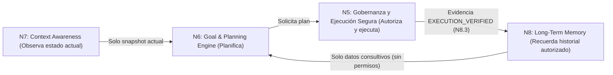
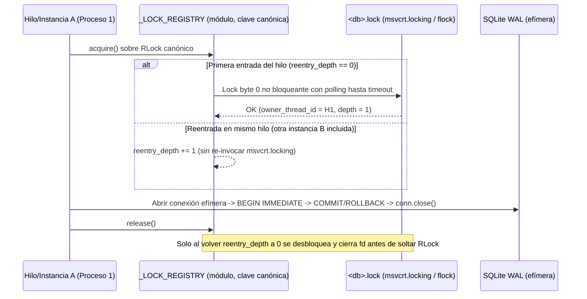

# J.A.R.V.I.S. — N8: Long-Term Memory & Experience (Fase N8.1)

> [!IMPORTANT]
> **Alcance implementado actualmente:** Este documento describe la base de persistencia, modelos, políticas y bloqueo de concurrencia implementada en **N8.1** (`src/memory/`).  
> Las capacidades de recuperación consultiva (`MemoryRetriever`), consola (`/memoria`, `/privado`, `/incognito`), captura automática post-ejecución, backups/purga avanzada e integración con N6/Multi-Brain están **reservadas para N8.2 y N8.3** y **todavía no forman parte del flujo conversacional activo**.

---

## 1. Arquitectura de N8.1 y Fronteras entre Capas

La separación conceptual del asistente se mantiene estricta:



**Principios de diseño vigentes en N8.1:**
- N8 **nunca** otorga permisos, modifica políticas ni aprueba acciones de `N5`.
- Su almacenamiento (`data/experiences.db`) es completamente **independiente** de `data/memory_store.json` (`ConversationMemory` efímera) y de la persistencia de N6 (`GoalStore`).
- En N8.1 **no** se realiza migración ni modificación de `data/memory_store.json`.
- El paquete `src/memory/` no importa módulos de audio, TTS, STT, consola ni clientes LLM.

---

## 2. Módulos Implementados (`src/memory/`)

| Archivo | Responsabilidad en N8.1 |
| :--- | :--- |
| [src/memory/models.py](file:///e:/Tiziano%20Facultad/J.A.R.V.I.S/jarvis-core/src/memory/models.py) | Enumeraciones (`MemoryCategory`, `MemorySource`, `MemoryStatus`, `MemoryScopeType`, `MemoryAuditAction`), máquina de estados `ALLOWED_MEMORY_TRANSITIONS`, excepciones tipadas, modelos inmutables (`MemoryRecord`, `MemoryRevision`, `MemoryAuditEntry`, `ExecutionVerificationEvidence`, `MemoryCreateInput`) y contratos DTO (`IntegrityReport`, `StoreStats`, `MemorySearchCandidate`). |
| [src/memory/policy.py](file:///e:/Tiziano%20Facultad/J.A.R.V.I.S/jarvis-core/src/memory/policy.py) | `MemoryPolicy`, `sanitize_memory_text()`, `normalize_text_for_search()`, `normalize_scope()`, `compute_content_fingerprint()`, detección de secretos sin filtración (`assert_no_secrets` con apoyo de `redact_secrets`), bloqueo de `INFERENCE`, validación de `ExecutionVerificationEvidence`, modo privado y defensa de rutas Windows (`validate_safe_local_db_path`). |
| [src/memory/migrations.py](file:///e:/Tiziano%20Facultad/J.A.R.V.I.S/jarvis-core/src/memory/migrations.py) | Esquema SQLite versionado v1 (`schema_migrations`, `store_metadata`, `memories`, `memory_revisions`, `memory_audit`, `memory_fts`), detección FTS5 (`unicode61 remove_diacritics 2`), índices B-tree/parciales y configuración `WAL` + `synchronous=FULL` + `secure_delete=ON` + `foreign_keys=ON`. |
| [src/memory/store.py](file:///e:/Tiziano%20Facultad/J.A.R.V.I.S/jarvis-core/src/memory/store.py) | `ExperienceStoreLock` (C4) y `ExperienceStore` con CRUD transaccional (`BEGIN IMMEDIATE`), dedupe por huella y procedencia, revisiones históricas, revocación lógica con purga FTS5, búsqueda FTS5/SQL `LIKE`, `verify_integrity` con cuarentena opcional y estadísticas. |
| [src/memory/__init__.py](file:///e:/Tiziano%20Facultad/J.A.R.V.I.S/jarvis-core/src/memory/__init__.py) | Superficie pública estable de contratos N8.1 preparada para N8.2 y N8.3. |

---

## 3. Esquema SQLite y Migraciones (`data/experiences.db`)

Versión actual del esquema: **`CURRENT_SCHEMA_VERSION = 1`**.

### Tablas y relaciones

1. **`schema_migrations`**: versión aplicada, nombre, fecha UTC y checksum SHA-256 del DDL.
2. **`store_metadata`**: metadatos de formato (`store_format`), disponibilidad y activación de FTS5 (`fts_available`, `fts_active`, `fts_tokenizer`).
3. **`memories`**: entidad principal con claves `CHECK` sobre `category`, `source`, `status`, `scope_type`, `confidence`, `importance`, `revision_number` y referencia autorreferencial `superseded_by -> memories(memory_id) ON DELETE SET NULL`.
   - **Índice único parcial `idx_memories_active_fingerprint`**: evita duplicar dos recuerdos `ACTIVE` con la misma huella canónica `(category, scope_type, scope_key, normalized_text)`.
   - **Índice único parcial `idx_memories_active_exec_provenance`**: evita reingestar la misma tarea verificada (`source_layer`, `source_execution_id`, `source_plan_id`, `source_task_id`) cuando ya existe un recuerdo `ACTIVE`.
4. **`memory_revisions`**: historial inmutable append-only de modificaciones (`UNIQUE(memory_id, revision_number)`, `ON DELETE RESTRICT`).
5. **`memory_audit`**: registro auditable de acciones (`CREATE`, `REVISE`, `REVOKE`, `EXPIRE`, `SUPERSEDE`, `DEDUPE_HIT`, `INTEGRITY_CHECK`, `MIGRATE`, `REJECT_PRIVATE_MODE`).
6. **`memory_fts`** *(virtual table FTS5 opcional)*: `unicode61 remove_diacritics 2`. No usa triggers implícitos que indexen estados inactivos; `ExperienceStore` inserta o actualiza únicamente filas `ACTIVE` y ejecuta `DELETE FROM memory_fts WHERE memory_id = ?` dentro de la misma transacción `BEGIN IMMEDIATE` al revocar, expirar o sustituir.

### Pragmas por conexión

Cada conexión efímera ejecuta `configure_connection()`:
- `PRAGMA foreign_keys = ON`
- `PRAGMA busy_timeout = 5000` (configurable vía `JARVIS_N8_SQLITE_BUSY_TIMEOUT_MS`)
- `PRAGMA secure_delete = ON` (sobrescribe con ceros páginas liberadas al purgar recuerdos de `memory_fts`)
- `PRAGMA synchronous = FULL`
- `PRAGMA temp_store = MEMORY`
- `PRAGMA journal_mode = WAL` en inicialización/migración.

---

## 4. Políticas de Ingesta y Modelo de Seguridad

| Regla | Implementación en N8.1 |
| :--- | :--- |
| **Categoría `INFERENCE`** | Bloqueada por defecto (`N8_ALLOW_INFERENCE_INGEST = False`). |
| **Matriz origen/categoría** | `USER_EXPLICIT` admite `FACT`, `PREFERENCE`, `DECISION`, `EXPERIENCE`; `DECISION_CONFIRMED` admite `DECISION`, `PREFERENCE`, `FACT`; `EXECUTION_VERIFIED` **solo** admite `EXPERIENCE` y `FACT`. |
| **Contrato `ExecutionVerificationEvidence`** | Exige `source_layer` en `{"N5_CHAIN_ORCHESTRATOR", "N6_EXECUTION_SUPERVISOR"}`, `execution_outcome == "verified"`, artefactos no vacíos, timestamp UTC válido, `approval_hash` SHA-256 de 64 hex obligatorio para N5 y verificación de integridad `evidence_sha256` contra carga canónica. |
| **Sanitización específica (`sanitize_memory_text`)** | No reutiliza `sanitize_untrusted_label()` de N7. Normaliza con `NFKC`, elimina caracteres invisibles `Cf`, `U+034F`, selectores de variación y secuencias de control/ANSI; preserva prosa técnica multilínea dentro de los presupuestos (`N8_MAX_TITLE_CHARS`, `N8_MAX_CONTENT_CHARS`, `N8_MAX_SUMMARY_CHARS`). |
| **Rechazo de secretos y transcripciones** | Detecta tokens/claves reutilizando `src/brain/exceptions.redact_secrets()` + encabezados PEM y asignaciones `.env`; bloquea claves de metadata sensibles mediante `is_sensitive_key()` sin exponer nunca el valor del secreto en mensajes de error. También rechaza delimitadores de prompt (`<\|im_start\|>`, `<script>`) y transcripciones conversacionales completas. |
| **Modo privado** | Cualquier escritura con `private_mode=True` lanza `MemoryPrivateModeError` antes de persistir datos ni dejar huella en tablas o auditoría. |
| **Protección de rutas Windows** | `validate_safe_local_db_path()` rechaza rutas UNC/SMB (`\\servidor\...`, `//...`, `\\?\UNC\...`), nombres reservados (`CON`, `NUL`, `COM1..9`, `LPT1..9`), variables `%...%` sin expandir, traversal `..`, symlinks/NTFS reparse points y directorios críticos del SO. |
| **Aislamiento de tests (`JARVIS_ENV=test`)** | Bloquea el acceso a `data/` real y redirige las bases de prueba al sandbox `temp/jarvis_test_isolated/`. |
| **Protección Git** | `.gitignore` y `GitSafetyGuard` (`src/utils/git_guard.py`) bloquean `*.db`, `*-wal`, `*-shm`, `*-journal`, `*.db.lock`, `*.corrupt.*`, `data/` y `data/memory_backups/`. |

---

## 5. Protocolo de Concurrencia `ExperienceStoreLock` (C4)



Todas las operaciones de lectura, escritura, migración y mantenimiento (`verify_integrity`, `get_stats`) usan este mismo protocolo.

---

## 6. Configuración (`config/settings.py`)

| Variable `.env` | Constante Python | Valor por defecto | Propósito |
| :--- | :--- | :--- | :--- |
| `JARVIS_N8_DB_PATH` | `EXPERIENCES_DB_PATH` | `data/experiences.db` | Ruta de producción (bloqueada en `JARVIS_ENV=test`). |
| `JARVIS_N8_BACKUP_DIR` | `MEMORY_BACKUP_DIR` | `data/memory_backups` | Carpeta reservada para respaldos N8.2. |
| `JARVIS_N8_ENABLED` | `N8_ENABLED` | `True` | Interruptor maestro del subsistema N8. |
| `JARVIS_N8_AUTO_CAPTURE_ENABLED` | `N8_AUTO_CAPTURE_ENABLED` | `False` | Reservado para N8.3 (desactivado en N8.1). |
| `JARVIS_N8_ALLOW_INFERENCE_INGEST` | `N8_ALLOW_INFERENCE_INGEST` | `False` | Mantiene `INFERENCE` deshabilitada en N8.1. |
| `JARVIS_N8_LOCK_TIMEOUT_SEC` | `N8_LOCK_TIMEOUT_SEC` | `5.0` | Timeout de espera para `ExperienceStoreLock`. |
| `JARVIS_N8_SQLITE_BUSY_TIMEOUT_MS` | `N8_SQLITE_BUSY_TIMEOUT_MS` | `5000` | Timeout interno SQLite (`PRAGMA busy_timeout`). |
| `JARVIS_N8_MAX_ACTIVE_MEMORIES` | `N8_MAX_ACTIVE_MEMORIES` | `5000` | Tope de recuerdos `ACTIVE`. |
| `JARVIS_N8_MAX_TITLE_CHARS` | `N8_MAX_TITLE_CHARS` | `120` | Límite de título. |
| `JARVIS_N8_MAX_CONTENT_CHARS` | `N8_MAX_CONTENT_CHARS` | `1200` | Límite de contenido sanitizado. |
| `JARVIS_N8_MAX_SUMMARY_CHARS` | `N8_MAX_SUMMARY_CHARS` | `280` | Límite de resumen breve. |
| `JARVIS_N8_MAX_REVISIONS_PER_MEMORY` | `N8_MAX_REVISIONS_PER_MEMORY` | `50` | Tope de revisiones por recuerdo. |
| `JARVIS_N8_FTS5_ENABLED` | `N8_FTS5_ENABLED` | `True` | Activa FTS5 si la compilación local lo soporta. |
| `JARVIS_N8_TEXT_MAX_*` / `N8_VOICE_MAX_*` | `N8_TEXT_MAX_ITEMS`, `N8_TEXT_MAX_CHARS`, `N8_VOICE_MAX_ITEMS`, `N8_VOICE_MAX_CHARS` | `5 / 1600 / 3 / 600` | Presupuestos reservados para recuperación N8.2/N8.3. |

---

## 7. Ejecución de Tests

En PowerShell con entorno virtual activo y aislamiento obligatorio:

```powershell
$env:JARVIS_ENV = "test"
.\venv\Scripts\python.exe -m unittest tests.test_memory_n8_persistence -v
```

Para validar la suite completa del repositorio:

```powershell
$env:JARVIS_ENV = "test"
.\venv\Scripts\python.exe -m unittest discover -s tests -p "test_*.py"
```

---

## 8. Contratos Preparados para N8.2 y N8.3 (Sin Implementar en N8.1)

- **Para N8.2 (`MemoryRetriever`, backups, purga, consola `/memoria`, `/privado`):**
  - `ExperienceStore.search_text_candidates()`, `list_memories(MemoryQueryFilter)`, `get_memory()`, `revoke_memory()`, `update_memory_with_revision()`, `transition_status()`, `verify_integrity()`, `get_stats()`, `acquire_lock()` y presupuestos `N8_TEXT_MAX_*` / `N8_VOICE_MAX_*`.
- **Para N8.3 (captura post-ejecución `EXECUTION_VERIFIED` e integración consultiva N6/Multi-Brain):**
  - Contrato estructurado `ExecutionVerificationEvidence` (validación SHA-256 de aprobación y artefactos), dedupe automático por `(source_layer, source_execution_id, source_plan_id, source_task_id)` y aislamiento de estado privado (`MemoryPrivateModeError`).

## 9. Limitaciones Conocidas en N8.1

- Aún no existe motor de ranking por relevancia/ámbito/antigüedad (`MemoryRetriever` pertenece a N8.2).
- `verify_integrity(quarantine_on_corruption=True)` aísla bases corruptas en `.corrupt.<uuid>`, mientras que la restauración automática desde snapshots de respaldo (`MEMORY_BACKUP_DIR`) y los comandos de purga manual pertenecen a N8.2.
- En pruebas donde un proceso distinto mantiene bloqueado un archivo de forma prolongada más allá de `N8_LOCK_TIMEOUT_SEC`, el contendedor falla de forma controlada con `MemoryLockTimeoutError` sin degradar el archivo de base de datos.
